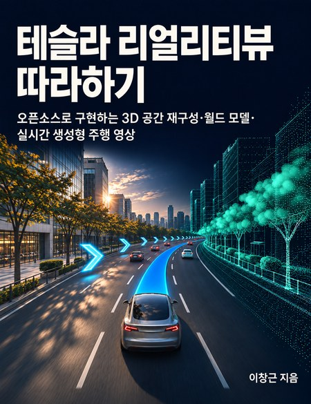

# open-reality-view-tutorial

<a href="https://wikidocs.net/book/22323"></a>

위키독스 책 **「테슬라 리얼리티뷰 따라하기」**([https://wikidocs.net/book/22323](https://wikidocs.net/book/22323))의 예제 코드 저장소입니다.

실제 차량이나 촬영 장비 없이, 공개 주행 데이터·CARLA·오픈소스 AI 모델만으로 차량 뒤 상공 가상 카메라 시점의 주행 영상을 만드는 세 가지 방법을 구현하고 비교합니다.

| 경로 | 방법 | 책 |
|---|---|---|
| Track A | 최적화 기반 3D Gaussian Splatting + Difix 보정 | 03장 |
| Track B | Feed-forward 3DGS (DrivingForward 등) | 04장 |
| Track C | 시각 특징 조건부 Video DiT + Flow Matching / MeanFlow + 자기회귀 생성 | 05~07장 |
| 통합 | 세 Track을 한 화면에서 비교하는 Open Reality View Lab | 08장 |

> 이 프로젝트는 Tesla, Inc.와 관련이 없는 독립적인 학습·연구용 자료입니다. 연구용 시각화이며 차량 제어나 운전 중 판단에 사용하지 마십시오.

## 기준 환경

- NVIDIA RTX 3090 24GB × 1, RAM 64GB, NVMe SSD 1~2TB
- Ubuntu 22.04 / 24.04, NVIDIA 드라이버, Docker, NVIDIA Container Toolkit
- 프로젝트별 Docker 컨테이너 (책 02-1 참조)

## 빠른 확인

```bash
git clone https://github.com/ady95/open-reality-view-tutorial.git ~/work/open-reality-view-tutorial
cd ~/work/open-reality-view-tutorial
docker run --rm --gpus "device=0" -v $PWD:/work -w /work \
  pytorch/pytorch:2.5.1-cuda12.4-cudnn9-runtime python env/gpu_check.py
```

## 디렉터리 구성

| 경로 | 내용 | 책 |
|---|---|---|
| `env/` | GPU 환경 점검 스크립트 | 02-1 |
| `docker/` | 프로젝트별 Dockerfile | 02장~ |
| `datasets/` | nuScenes 확인, 공통 매니페스트 | 02-2, 02-5 |
| `simulation/` | CARLA 데이터 수집, 클립 내보내기 | 02-4, 05-4, 06-2 |
| `geometry/` | 좌표 변환, 추격 카메라 | 02-3 |
| `reconstruction/` | DriveStudio 렌더, 3DGS 피팅, Difix 보정 | 03장 |
| `viewer/` | 리얼리티뷰 1.0 합성·웹 뷰어 | 03-6 |
| `feedforward/` | DrivingForward 추론 | 04-2, 07-1 |
| `world_models/` | Self-Forcing 측정, Video DiT(FM·MeanFlow) 학습·평가, 실사 데이터 변환 | 05장, 06-1 |
| `patches/` | Cosmos-Transfer2.5 텍스트 인코더 분리 패치 | 06-2 |
| `optimization/` | 정밀도·compile·TensorRT·INT8·TAESD 벤치마크 | 07-1 |
| `evaluation/` | 인과적 벤치마크, 결과 영상 생성 | 07-2, 05-6~07-2 |
| `lab/` | Open Reality View Lab 통합 뷰어 | 08-1 |
| `docs/` | README용 이미지 | - |

실행 순서와 각 실험의 조건은 책의 부록 D에 정리되어 있습니다.

## 라이선스

이 저장소의 코드는 [MIT License](LICENSE)를 따릅니다.

모델 가중치와 데이터셋은 이 저장소에 포함하지 않으며, 각 장의 준비 스크립트가 공식 배포처에서 내려받습니다. 가중치·데이터셋은 코드와 라이선스가 다를 수 있습니다. 예를 들어 Difix/Difix-ref는 NVIDIA 비상업 라이선스, Argoverse 2는 CC BY-NC-SA 4.0입니다. 사용 전 각 배포처의 조건을 확인하십시오.
